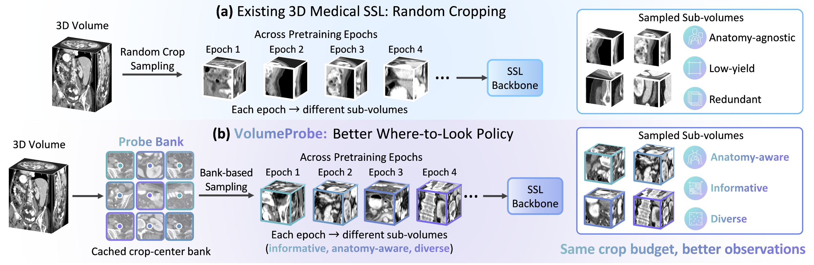
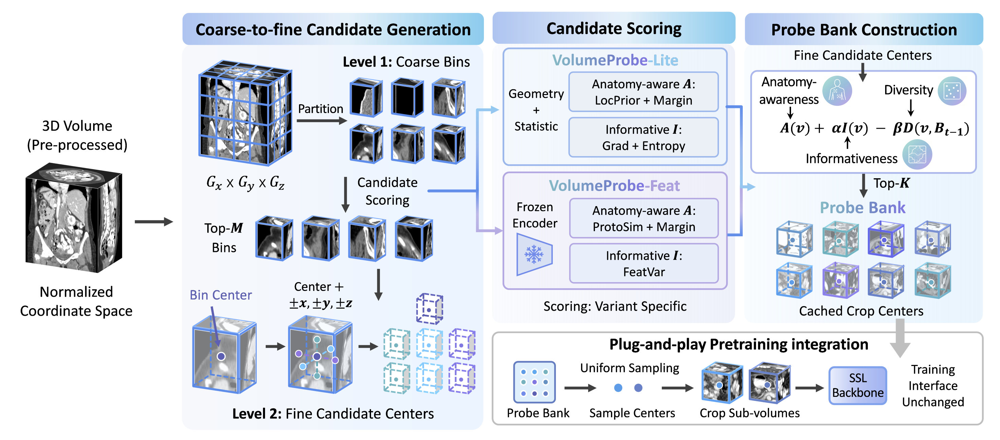
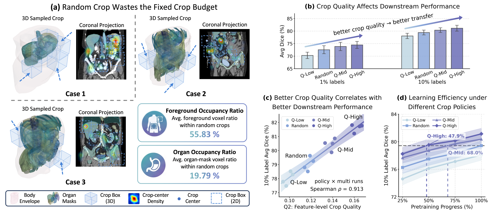

<div align="center">
  <h1>VolumeProbe</h1>
  <h2>Where to Look Matters:<br>Rethinking Sub-Volume Sampling in 3D Medical Self-supervised Learning</h2>

  <p>
    <!-- arXiv URL: -->
    
    <!-- Paper URL: -->
    
    <a href="https://volumeprobe.github.io/"></a>
  </p>

  <p>
    <a href="https://scholar.google.com/citations?user=w6XeRtAAAAAJ">Junkai Liu</a>,
    <a href="https://scholar.google.com/citations?hl=en&amp;user=gpbEdHEAAAAJ">Le Zhang</a>
  </p>

  <p>School of Engineering, University of Birmingham</p>
</div>

**VolumeProbe** is a training-free, plug-and-play sub-volume sampling framework for **3D medical self-supervised learning**. It replaces random cropping with an offline probe bank, improving observations under the **same crop budget** while keeping the SSL backbone and training objective unchanged.

<p align="center">
  
</p>

## 📑 Table of Contents

- [🔎 Overview](#-overview)
- [🎯 Motivation](#-motivation)
- [💡 Key Ideas and Features](#-key-ideas-and-features)
- [📊 Experimental Scope](#-experimental-scope)
- [🗂️ Dataset](#️-dataset)
- [📁 Repository Layout](#-repository-layout)
- [🛠️ Usage](#️-usage)
- [📜 License](#-license)
- [🙏 Acknowledgements](#-acknowledgements)
- [📮 Contact](#-contact)
- [🔗 Citation](#-citation)

## 🔎 Overview

Our core idea is to revisit random cropping as a **where-to-look** problem. Instead of treating all spatial regions as equally useful, VolumeProbe allocates the fixed crop budget to sub-volumes guided by **anatomy-awareness, informativeness, and diversity**.

For each 3D volume, it constructs a cached bank of crop centers offline. During pretraining, it uniformly samples a center from that volume's bank, adds local jitter, and extracts a sub-volume for the unchanged SSL pipeline.

<p align="center">
  
</p>

## 🎯 Motivation

Random sub-volume cropping can spend the fixed crop budget on low-yield, boundary-dominated, or redundant regions. Controlled crop-quality experiments show that better observations improve downstream transfer and learning efficiency, motivating a more deliberate sampling policy.

<p align="center">
  
</p>

## 💡 Key Ideas and Features

VolumeProbe is built around three main principles.

<table>
  <thead>
    <tr>
      <th align="left" width="34%">Principle</th>
      <th align="left">Description</th>
    </tr>
  </thead>
  <tbody>
    <tr>
      <td>🧠 <b>Anatomy-awareness</b></td>
      <td>Encourages crop centers to lie in anatomically plausible and meaningful body regions.</td>
    </tr>
    <tr>
      <td>🔍 <b>Informativeness</b></td>
      <td>Prioritizes sub-volumes with richer local structures using image-statistical or feature-level cues.</td>
    </tr>
    <tr>
      <td>🧩 <b>Diversity</b></td>
      <td>Discourages the probe bank from collapsing to nearby or redundant locations.</td>
    </tr>
  </tbody>
</table>

**Training-free and plug-and-play:** the probe bank is built offline and reused without learnable sampling parameters or changes to the SSL backbone, objective, or crop budget.

**VolumeProbe-Lite** uses geometric and image-statistical cues without external encoders. **VolumeProbe-Feat** uses frozen visual features to study the value of richer semantic cues.

## 📊 Experimental Scope

The experiments isolate the effect of **where the crop budget is spent**. We compare random cropping with probe-bank sampling in **VoCo, S2DC, and MedGMAE**, keeping each baseline's SSL backbone, objective, and crop budget fixed.

Transfer is assessed through segmentation, classification, and registration. Crop-quality analyses examine informativeness, redundancy, learning efficiency, and representation structure to explain how sampling affects transfer.

The current code release includes **VolumeProbe-Lite pretraining and downstream segmentation**. The paper also covers VolumeProbe-Feat diagnostics and the broader downstream evaluations listed below.

## 🗂️ Dataset

### Pretraining datasets

| Dataset | Download |
| --- | --- |
| VoCo-10k | [Hugging Face](https://huggingface.co/datasets/Luffy503/VoCo-10k) |
| AbdomenAtlas1.0Mini | [Hugging Face](https://huggingface.co/datasets/Luffy503/VoCo_Downstream/tree/main/Dataset224_AbdomenAtlas1.0) |

For VoCo-10k, organize the extracted datasets as follows:

```text
data/
├── BTCV/
├── TCIAcovid19/
├── Luna16/
├── stoic21/
├── Totalsegmentator_dataset/
├── Flare23/
└── HNSCC_convert_v1/
```

### Downstream datasets

Use [VoCo_Downstream on Hugging Face](https://huggingface.co/datasets/Luffy503/VoCo_Downstream) as the download hub for the downstream datasets. Our evaluation covers:

| Task | Datasets |
| --- | --- |
| Segmentation | BTCV, AMOS, WORD, and Atlas-MRI |
| Classification | CC-CCII |
| Registration | IXI and OASIS |

## 📁 Repository Layout

```text
VolumeProbe/
├── VoCo/                                    # VoCo pretraining
├── S2DC/                                    # S2DC pretraining
├── MedGMAE/                                 # MedGMAE pretraining
├── pretraining/                             # Shared data and training utilities
├── downstream/                              # Segmentation fine-tuning and evaluation
├── jsons/                                   # Dataset split manifests
├── volumeprobe_lite.py                      # Probe scoring and sampling
├── build_volumeprobe_cache_VoCo10k.py       # VoCo-10k probe bank
├── build_volumeprobe_cache_AbdomenAtlas.py  # AbdomenAtlas probe bank
├── assets/                                  # README figures
├── requirements.txt
├── LICENSE                                  # Apache-2.0
└── README.md
```

## 🛠️ Usage

Use Python 3.11 with a CUDA-enabled PyTorch build. Run from the repository root; each script's `--help` lists the required data, cache, checkpoint, and output arguments.

```bash
python -m pip install -r requirements.txt
```

### Pretraining

| Step | Script |
| --- | --- |
| Build the VoCo-10k probe bank | [build_volumeprobe_cache_VoCo10k.py](build_volumeprobe_cache_VoCo10k.py) |
| Build the AbdomenAtlas probe bank | [build_volumeprobe_cache_AbdomenAtlas.py](build_volumeprobe_cache_AbdomenAtlas.py) |
| Pretrain VoCo | [voco_train_VolumeProbe.py](VoCo/voco_train_VolumeProbe.py) |
| Pretrain S2DC | [s2dc_train_VolumeProbe.py](S2DC/s2dc_train_VolumeProbe.py) |
| Pretrain MedGMAE | [MedGMAE_train_VolumeProbe.py](MedGMAE/MedGMAE_train_VolumeProbe.py) |

Match the probe bank's preprocessing and crop size to the selected baseline.

### Fine-tuning and evaluation

Use `main_baseline.py` in the relevant [downstream task directory](downstream): fine-tune from a pretrained checkpoint, or add `--eval_only` to evaluate a fine-tuned checkpoint.

### Single / multiple GPUs

Replace `SCRIPT.py` with a training or evaluation entry above and append its required arguments. Multi-GPU runs use Linux/NCCL.

```bash
python SCRIPT.py
torchrun --standalone --nproc_per_node=4 SCRIPT.py
```

## 📜 License

VolumeProbe's source code is distributed under the [Apache License 2.0](LICENSE). External libraries, adapted code, and datasets retain the licenses and usage conditions specified by their original providers.

## 🙏 Acknowledgements

We thank the teams behind [MONAI](https://github.com/Project-MONAI/MONAI), [VoCo](https://github.com/Luffy03/VoCo) and [Large-Scale-Medical](https://github.com/Luffy03/Large-Scale-Medical), [S2DC](https://github.com/Ashespt/S2DC), and [MedGMAE](https://github.com/windrise/MedGMAE) for making their implementations and resources publicly available. Their contributions supported the development and evaluation of VolumeProbe.

## 📮 Contact

Questions, feedback, and research discussions about VolumeProbe are welcome. Reach out to Junkai Liu via [jxl1920@student.bham.ac.uk](mailto:jxl1920@student.bham.ac.uk) or [liujk1997@gmail.com](mailto:liujk1997@gmail.com).

## 🔗 Citation

Please cite the VolumeProbe paper when using our method or code in your research. A GitHub star ⭐ is also appreciated if you find the project useful.

We will provide the BibTeX reference here after the preprint is published on arXiv.

```bibtex

```
